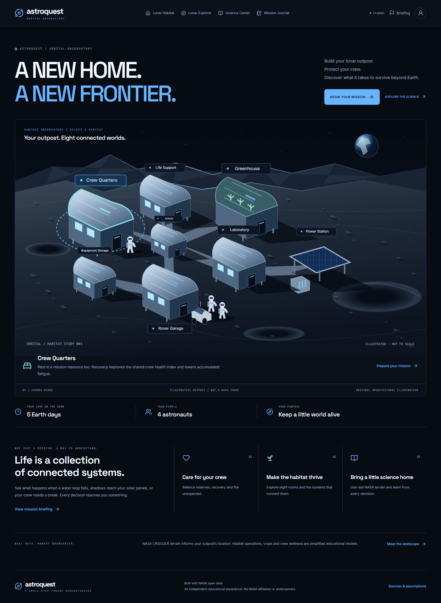
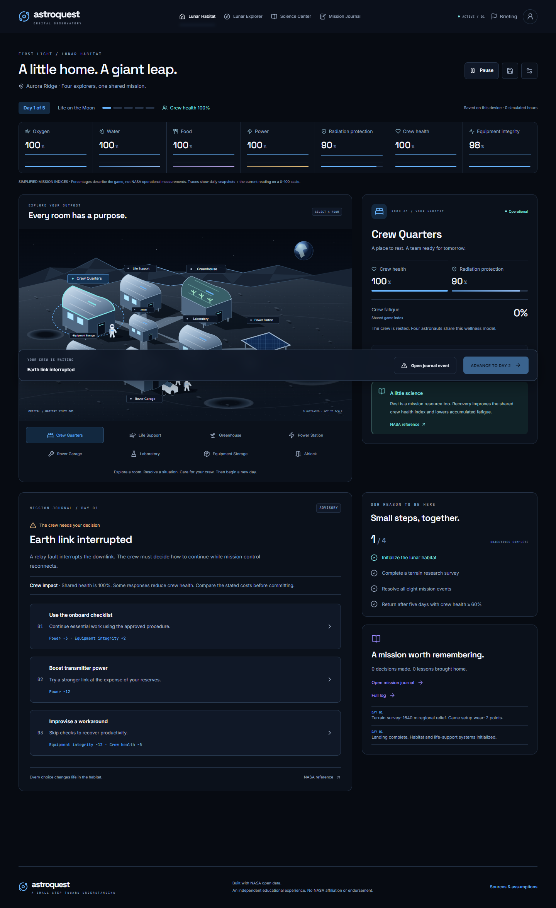
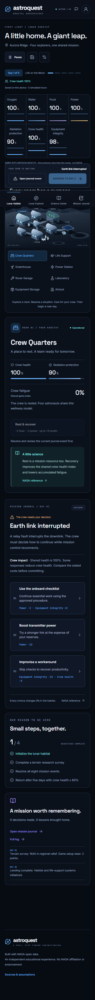
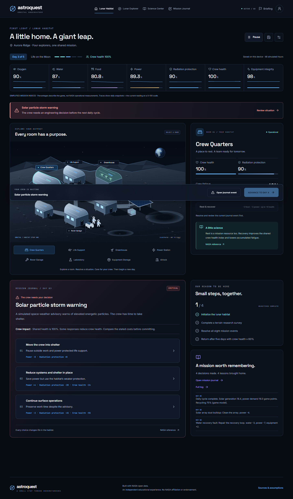
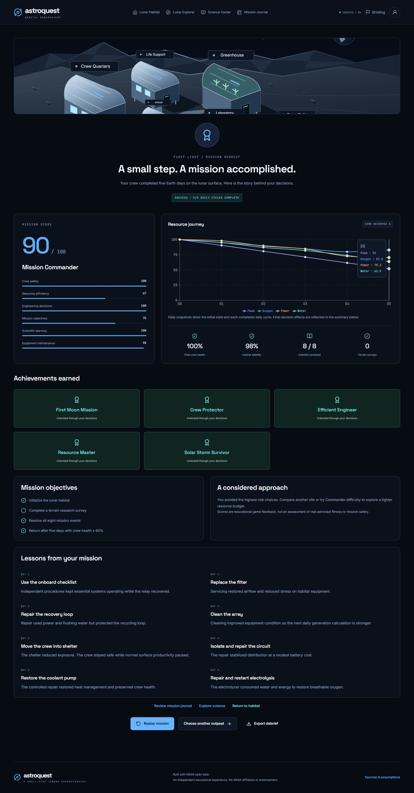
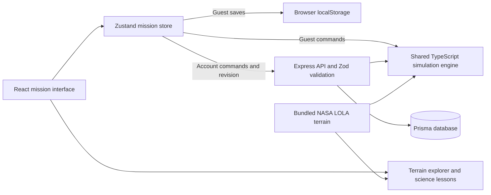

# 🌙 AstroQuest — Living on the Moon

**Build a lunar home. Protect your crew. Discover the science behind survival.**


An interactive lunar mission simulator that helps students and junior astronaut learners explore life beyond Earth through resource management, engineering decisions, and mission-based learning.

**5 Earth-day cycles · 4 crew members · 8 engineering events · 3 exploration regions**

[Getting started](#installation-and-setup) · [Screenshots](#screenshots--demo-gallery) · [Architecture](#project-architecture) · [Scientific references](#scientific-references) · [Repository](https://github.com/fahad9845/NASA-AstroQuest)

> **Educational simulation:** AstroQuest is a learning experience, not an actual astronaut training system or an operational mission-planning tool. NASA data and references inform the experience; the game mechanics are simplified. This is an independent project, with no NASA affiliation or endorsement implied.

## Project Overview

AstroQuest places learners in charge of a small lunar outpost. Keep essential supplies available, respond to equipment faults, care for the crew, and complete a five-day mission. Every engineering decision changes the mission state and explains the science behind its consequences.

The current **Orbital Observatory** interface combines a dark mission-control theme with an interactive habitat, clear telemetry, a lunar terrain explorer, and a chronological mission journal. Learners can play as guests with device saves or create an account for server-persisted missions.

## Problem Statement

Space exploration depends on connected systems: producing oxygen needs water and power, equipment failures change reserve use, and crew protection can limit outside work. Learning those relationships from isolated facts can make the engineering decisions difficult to picture.

The [Build a Junior Astronaut Mission Trainer challenge](https://www.spaceappschallenge.org/2026/challenges/junior-astronaut-mission-trainer/) calls for an interactive experience that makes outpost management and mission trade-offs understandable to young learners. AstroQuest turns those relationships into decisions a player can make, observe, and reflect on.

## Our Solution

AstroQuest uses a **decide → observe → understand → adapt** learning loop. Players face a situation, compare engineering responses, see their actual resource effects, and review a short scientific explanation before continuing.

Real NASA terrain gives the mission a scientific foundation. A separate, deterministic simulation model makes the consequences reproducible and understandable. Scientific observations, reference material, and authored game assumptions are identified separately throughout the application.

## Key Features

| Feature | What is implemented |
| --- | --- |
| Playable lunar mission | Five daily cycles, four crew members, Cadet/Commander difficulty, mission success, failure, abort, and restart |
| Resource management | Oxygen, water, food, power, radiation protection, crew health, and equipment integrity; daily consumption and generation |
| Interactive habitat | Eight selectable rooms with relevant system readings, actions, and scientific explanations |
| Engineering emergencies | Eight events, each with three choices, immediate consequences, and a decision-specific debrief |
| Crew assignments | One optional activity per day: survey, maintenance, conservation, rest, crop tending, or a mature crop harvest |
| NASA terrain integration | An interactive LOLA elevation map, three region comparisons, provenance, units, and terrain-dependent game costs |
| Mission journal | Daily records, decisions, reviewed science, crew/resource snapshots, and earned achievements |
| Performance report | Mission outcome, score dimensions, resource history, badges, replay, and JSON debrief export |
| Persistence | Browser guest saves plus account registration, sign-in, saved missions, and server-validated commands |
| Responsive experience | Desktop/mobile layouts, keyboard room selection, resource dialogs, reduced-motion support, and loading/error states |

The greenhouse starts with a **fictional pre-grown crop**. Its growth and yield are teaching mechanics; the game does not suggest that a full crop can grow from seed in five days.

## How AstroQuest Works

1. **Read the briefing.** Select a fictional outpost positioned on a real NASA terrain sample, choose a difficulty, and initialize the mission.
2. **Inspect the habitat.** Select a room to review its purpose, resources, crew needs, and available actions.
3. **Respond to events.** Compare the engineering choices and commit to a response. Resource changes appear immediately.
4. **Review the science.** Read and acknowledge the outcome before making the next decision.
5. **Assign an optional activity.** Rest, maintain systems, conserve power, tend or harvest the crop, or complete a terrain survey.
6. **Advance the day.** The engine calculates consumption, recycling, generation, equipment wear, and crew effects.
7. **Review your mission.** Survive all five cycles to complete the mission, inspect the report, and replay with another approach.

**Time advances by player action.** This is a turn-based simulation with immediate decision feedback, not a continuously running clock. Leaving the tab open does not consume supplies. Depleting essential reserves, crew health, or equipment can end the mission early.

For a first run, follow the first engineering option for each event and complete a terrain survey after the first day's debriefs. See [game mechanics](docs/GAME_MECHANICS.md) for the complete rules.

## Screenshots / Demo Gallery

**Live demo:** [Add deployed demo URL](https://YOUR-DEMO-URL.example) — **placeholder**. A hosted deployment has not yet been verified. The project is playable locally using the instructions below.

The following screenshots are included in this repository and show the implemented application.

### AstroQuest landing page



<details>
<summary><strong>Lunar mission dashboard</strong> — habitat, crew, telemetry, and mission controls</summary>



</details>

<details>
<summary><strong>Resource management</strong> — mobile telemetry and contextual room controls</summary>

This mobile mission view includes the resource overview, crew readings, and room-specific actions.



</details>

<details>
<summary><strong>Emergency simulation</strong> — solar particle warning and engineering choices</summary>



</details>

<details>
<summary><strong>Mission completion report</strong> — score, resource history, and achievements</summary>



</details>

Additional views: [Science Center](docs/screenshots/science-desktop.png) · [Mission Journal](docs/screenshots/journal-desktop.png) · [Mobile landing](docs/screenshots/landing-mobile.png).

<!-- Optional screenshot placeholder: add the image before uncommenting.

-->

## Technology Stack

The stack below is based on the project configuration and source. Exact dependency versions are recorded in [package-lock.json](package-lock.json).

| Layer | Technologies | Role |
| --- | --- | --- |
| Frontend | React 19, TypeScript 5, React Router 7 | Typed components and application routes |
| Build tools | Vite 6, esbuild, tsx | Frontend development/build, API bundling, and TypeScript execution |
| Styling and interaction | Tailwind CSS 3, custom CSS tokens, Radix UI, Lucide, Framer Motion | Responsive Orbital interface, accessible dialogs/tooltips, icons, and transitions |
| Visualization | SVG, Canvas, Recharts | Interactive habitat, NASA terrain map, telemetry, and results charts |
| State and data fetching | Zustand 5, TanStack Query 5 | Mission state, persistence coordination, and server queries |
| Backend | Node.js, Express 4, Zod, Helmet, CORS, rate limiting | REST API, input validation, access checks, and mission commands |
| Database | Prisma 6; SQLite locally; PostgreSQL schema/migrations supplied | Accounts, sessions, missions, decisions, results, and achievements |
| Authentication | Node.js `crypto`, salted scrypt password hashes, opaque HttpOnly session cookies | Custom account authentication; Secure cookies in production |
| Scientific resources | NASA PDS LRO/LOLA terrain, NASA SVS imagery, NASA reference material | Data-backed exploration and educational context |
| Testing | Vitest 4, React Testing Library, Supertest, Playwright | Engine, component, API, NASA integration, and browser verification |
| Deployment configuration | Vercel frontend configuration, Render Node-service blueprint | Prepared hosting paths; hosted deployment remains unverified |

SQLite is the tested local database. PostgreSQL support includes a matching schema and migrations, but has not been verified against a hosted database.

## Project Architecture

The simulation engine is separate from React and reused by guest gameplay and the account API.



- **Simulation engine:** Calculates daily changes, decision consequences, activity rules, outcomes, and scores. The same options and command sequence produce the same result.
- **Web application:** Presents the habitat and science experience, stores guest progress, and sends account commands to the API.
- **Account API:** Validates ownership and mission revisions, calculates state on the server, and persists changes through Prisma. Clients cannot submit arbitrary scores or replacement mission states.
- **NASA data layer:** Uses a reviewed archival dataset bundled with the project. Server delivery is checked against that bundle, with visible status, retry controls, and an authentic cached fallback.

Further documentation: [Architecture](docs/ARCHITECTURE.md) · [API](docs/API_DOCUMENTATION.md) · [Database schema](docs/DATABASE_SCHEMA.md) · [Orbital design](docs/ORBITAL_DESIGN.md).

## Installation and Setup

### Prerequisites

- **Node.js 20.18 or newer**, as specified in `package.json`. The Render template uses Node.js 22.
- **npm**, included with Node.js.
- **Git** and a modern web browser.
- An internet connection for dependency installation. **No NASA API key or cloud database account is required for local setup.**

### 1. Clone the repository

```bash
git clone https://github.com/fahad9845/NASA-AstroQuest.git
cd NASA-AstroQuest
```

Run all subsequent commands from the directory containing `package.json`.

### 2. Install dependencies

```bash
npm ci
```

This installs the versions recorded in the lockfile.

### 3. Create the local environment file

On **macOS/Linux**:

```bash
cp .env.example .env
```

On **Windows PowerShell**:

```powershell
Copy-Item .env.example .env
```

The supplied defaults use local SQLite. Leave `DATABASE_URL="file:./astroquest.db"` for this setup.

### 4. Initialize the local database

```bash
npm run db:setup
```

This creates the SQLite file if needed, generates the SQLite Prisma client, and applies the checked-in migrations. Local account data is stored in `prisma/sqlite/astroquest.db`, which is ignored by Git.

The processed NASA terrain, source label, and illumination image are already included. A fresh clone does not need to download NASA data before playing.

## Running the Project Locally

### Start the complete application

```bash
npm run dev
```

| Service | Local address |
| --- | --- |
| React application | [http://127.0.0.1:5173](http://127.0.0.1:5173) |
| Express API | `http://127.0.0.1:3001/api` |
| API/database health | [http://127.0.0.1:3001/api/health](http://127.0.0.1:3001/api/health) |

The development server forwards `/api` requests to Express. Start a guest mission immediately, or open **Commander Profile** to register. For account persistence, select the account-saving option in the mission briefing.

### Frontend-only development

```bash
npm run dev:web
```

Guest gameplay works without the account API. Progress saves in the current browser; accounts require the backend. This does not provide a service worker or guarantee a fresh offline page load.

### Production build

```bash
npm run build
```

The command type-checks the project and creates:

- `dist/client/` — the frontend, fonts, and NASA assets.
- `dist/api/index.js` — the bundled Express server.

For a configured production host, set `NODE_ENV=production`, `DATABASE_URL`, and the correct `WEB_ORIGIN`, then run:

```bash
npm start
```

In production mode, Express serves both the API and built frontend. Production account cookies require HTTPS. For a local check of the built application after SQLite setup, use:

```bash
node scripts/smoke-production.mjs
```

The smoke script temporarily starts the built app on port `3002`, checks guest gameplay and supporting routes, then closes its server. A frontend-only build is also available through `npm run build:web`.

### Tests and verification

```bash
npm run typecheck
npm test
npm run test:e2e
```

The latest recorded application verification includes **90 unit/API/component tests** and **28 desktop/mobile browser tests**, plus a production build and smoke test. These are recorded local results, not a live CI badge; see [verification status](docs/DELIVERY_STATUS.md).

Playwright currently uses installed **Microsoft Edge**. For a machine without Edge, install Chromium with `npx playwright install --with-deps chromium` and remove the two `channel: 'msedge'` entries from `playwright.config.ts`. See [testing instructions](docs/TESTING.md) for setup, test isolation, and report locations. Generate the SQLite client before running the SQLite-based API tests.

### Deployment options

| Option | Repository support | Configuration needed |
| --- | --- | --- |
| Single Node service | Express serves the API and frontend; `render.yaml` supplies build/start commands | PostgreSQL `DATABASE_URL`, HTTPS origin in `WEB_ORIGIN`, `NODE_ENV=production`; leave `VITE_API_URL` empty and use `COOKIE_SAME_SITE=lax` for the same-origin setup |
| Vercel frontend + Render API | `vercel.json` supplies frontend build/output and route fallback; `render.yaml` configures the API service | Frontend `VITE_API_URL`; matching backend `WEB_ORIGIN`; HTTPS and `COOKIE_SAME_SITE=none` for cross-site cookies |
| Static guest demo | Frontend build with `VITE_GUEST_ONLY=true`; account controls become guest-history controls | Set the variable in the build environment, run `npm run build:web`, publish `dist/client`, and configure SPA route fallback |

For PostgreSQL, configure its connection URL and run `npm run db:postgres` to generate the appropriate Prisma client and apply migrations. Do not use the SQLite setup command with a PostgreSQL URL. The Render blueprint already includes its own PostgreSQL generation and migration steps.

Hosting configuration is supplied; cloud provisioning and hosted PostgreSQL verification remain to be completed. Follow the [deployment guide](docs/DEPLOYMENT.md) for origin, cookie, database, and hosting details.

## Environment Variables

The root [.env.example](.env.example) documents the available settings. Copy it to `.env` for the **API and Prisma**.

| Variable | Local default | Purpose |
| --- | --- | --- |
| `DATABASE_URL` | `file:./astroquest.db` | SQLite connection locally; PostgreSQL connection for a configured production database |
| `PORT` | `3001` | Express server port |
| `WEB_ORIGIN` | `http://localhost:5173,http://127.0.0.1:5173` | Comma-separated exact frontend origins allowed by the API |
| `NODE_ENV` | `development` | Enables production static serving and Secure cookies when set to `production` |
| `VITE_API_URL` | Empty | Public API origin; empty uses same-origin requests or the Vite development proxy |
| `VITE_GUEST_ONLY` | `false` | Set `true` for a static build without account services |
| `COOKIE_SAME_SITE` | `lax` | Cookie policy; use `none` for a configured cross-site HTTPS deployment |

**Frontend configuration:** Vite's root is `apps/web`. Supply `VITE_*` settings through your shell/hosting build environment or an ignored `apps/web/.env.local` file. Vite does not automatically read the repository-root `.env` with the current configuration. Restart the dev server or rebuild after changing frontend settings.

`VITE_*` values are public browser configuration. Keep database credentials and other secrets out of them. Environment files, databases, dependencies, generated builds/reports, and local hosting metadata are excluded by [.gitignore](.gitignore); `.env.example` and `package-lock.json` belong in the repository.

## Project Folder Structure

```text
NASA-AstroQuest/
├── apps/
│   ├── web/
│   │   ├── public/nasa/             # Cached NASA illumination image
│   │   ├── src/
│   │   │   ├── components/         # Habitat, navigation, telemetry, UI primitives
│   │   │   ├── pages/              # Landing, briefing, mission, science, results
│   │   │   ├── stores/             # Zustand mission state and persistence
│   │   │   ├── services/           # API client, query setup, NASA delivery
│   │   │   ├── data/nasa/          # Reviewed terrain JSON and PDS source label
│   │   │   ├── hooks/              # Shared authentication query
│   │   │   ├── orbital-tokens.css  # Shared visual tokens
│   │   │   ├── orbital.css         # Observatory presentation
│   │   │   ├── habitat.css         # Responsive habitat layouts
│   │   │   ├── styles.css          # Base/shared styles
│   │   │   ├── App.tsx             # Providers and routes
│   │   │   └── main.tsx            # React entry point
│   │   └── index.html
│   └── api/src/                    # Express routes, authentication, database access
├── packages/
│   ├── simulation-engine/          # Pure mission rules, events, scoring, validation
│   └── shared-config/              # Lessons and scientific source references
├── prisma/
│   ├── schema.prisma               # PostgreSQL schema
│   ├── migrations/                 # PostgreSQL migrations
│   └── sqlite/                     # SQLite schema and migrations
├── tests/                          # Engine, API, component, NASA and browser tests
├── scripts/                        # Database setup, NASA ingestion, replay, previews
├── docs/
│   └── screenshots/                # Captured application images
├── .env.example                    # Environment template
├── package.json
├── package-lock.json
├── vite.config.ts
├── playwright.config.ts
├── render.yaml                     # Node service deployment blueprint
├── vercel.json                     # Frontend deployment configuration
└── README.md
```

## Future Improvements

The following are **planned directions, not implemented features or delivery promises**:

- [ ] Longer missions and additional lunar or Martian scenarios.
- [ ] Classroom-oriented learning assessment and teacher feedback tools.
- [ ] Optional audio guidance, localization, and further accessibility evaluation.
- [ ] Offline-first startup through a service worker.
- [ ] Account email verification and password recovery.
- [ ] Broader Safari, Firefox, physical-device, and screen-reader testing.
- [ ] Verified hosted PostgreSQL deployment and a public demo URL.

## NASA Space Apps Challenge Context

AstroQuest was developed for the **NASA Space Apps Challenge**, under **[Build a Junior Astronaut Mission Trainer](https://www.spaceappschallenge.org/2026/challenges/junior-astronaut-mission-trainer/)**.

The project connects that challenge to a complete learning experience:

| Challenge focus | AstroQuest response |
| --- | --- |
| Make mission decisions tangible | Players manage an outpost and see the consequences of each engineering response |
| Connect life-support systems | Water, oxygen, power, equipment, food, and crew condition affect mission outcomes |
| Encourage scientific exploration | NASA terrain informs region selection and clearly labeled game costs |
| Support learning through play | Decision debriefs, contextual room insights, and a reviewable mission journal |

The [presentation guide](docs/PRESENTATION.md) provides a demo narrative. [Game mechanics](docs/GAME_MECHANICS.md) and the [QA report](docs/QA_REPORT.md) explain the model and verification coverage for reviewers.

## Scientific References

### What comes from NASA—and what the game assumes

| Category | Source/use in AstroQuest | Boundary |
| --- | --- | --- |
| Numerical terrain data | NASA LRO/LOLA `LDEM_4` V3.0, a PDS3 elevation raster; sampled elevations and derived regional relief | Heights are in metres relative to a 1,737,400 m reference sphere. The native 0.25° grid provides regional context, not landing-site or rover safety certification. |
| Scientific imagery | NASA SVS south-pole illumination visualization | The cached image illustrates light and shadow; its brightness is not converted into a power forecast. |
| Educational references | NASA life-support, lunar environment, and plant-growth material | ISS examples inform hypothetical lunar lessons; they do not validate this fictional habitat. |
| Simulation assumptions | Resource percentages, crew indices, crop behavior, sunlight schedules, event timing, and score rules | Authored educational mechanics, not NASA observations, physiological predictions, or physical system specifications. |

Measured terrain has a functioning gameplay role: regional relief changes the outpost's initial equipment wear and a survey's power cost. **The conversion from terrain relief to game points is authored**, not a NASA engineering model. There is no live solar-storm prediction or live NASA telemetry feed.

### Sources and attribution

- **Terrain:** [NASA PDS Geosciences Node — LDEM_4 source label](https://pds-geosciences.wustl.edu/lro/lro-l-lola-3-rdr-v1/lrolol_1xxx/data/lola_gdr/cylindrical/img/ldem_4.lbl) and [Lunar Orbital Data Explorer](https://ode.rsl.wustl.edu/moon/). Credit: NASA LRO/LOLA Science Team; NASA PDS Geosciences Node, Washington University in St. Louis.
- **Illumination:** [NASA SVS — Illumination at the Moon's South Pole, 2025–2028](https://svs.gsfc.nasa.gov/5027). Credit: NASA/Goddard Space Flight Center Scientific Visualization Studio.
- **Life support:** [NASA — Environmental Control and Life Support Systems](https://www.nasa.gov/reference/environmental-control-and-life-support-systems-eclss/). Reference for air revitalization, water treatment, and oxygen generation.
- **Lunar environment:** [NASA Science — Weather on the Moon](https://science.nasa.gov/moon/weather-on-the-moon/) and [Moon Facts](https://science.nasa.gov/moon/facts/). Context for radiation, temperature, regolith, and the lunar environment.
- **Plant growth:** [NASA — Growing Plants in Space](https://www.nasa.gov/exploration-research-and-technology/growing-plants-in-space/). Context for controlled plant growth and supplemental food.
- **Further exploration:** [NASA Moon Trek](https://trek.nasa.gov/moon/), available through external exploration links.

The illustrated outpost is original interface artwork, not a NASA photograph or a reconstruction of an actual lunar facility. Fictional outpost names do not identify NASA-selected landing sites.

The [NASA data provenance document](docs/NASA_DATA_SOURCES.md) records source endpoints, units, coordinate frame, transformations, checksums, and limitations. The original label and processed grid are included in the repository. To reproduce data ingestion, with an internet connection:

```bash
npm run data:fetch
```

This command validates the source label, downloads/caches the raster, derives the display grid and regional samples, and retains source metadata. It is optional for normal installation and gameplay.

## Contributors

Repository: **[fahad9845/NASA-AstroQuest](https://github.com/fahad9845/NASA-AstroQuest)**. GitHub's [contributors page](https://github.com/fahad9845/NASA-AstroQuest/graphs/contributors) records commit contributions after they are pushed.

**Team credits — to complete:** Add the actual contributor names, GitHub profiles, and roles before the final submission.

| Contributor | Role |
| --- | --- |
| Your name / GitHub profile | Add your contribution |
| Additional team member, if applicable | Add their contribution |

Bug reports, usability feedback, and scientific corrections can be submitted through [repository issues](https://github.com/fahad9845/NASA-AstroQuest/issues). Include reproduction steps and the relevant page or mission decision when reporting a problem.

## License

**License selection pending.** No `LICENSE` file is currently included in the repository. Add the chosen license and update this section before describing the project as openly licensed.

Third-party dependencies, fonts, and NASA resources retain their respective terms and attribution requirements. Their inclusion does not imply NASA endorsement or certification of AstroQuest.
