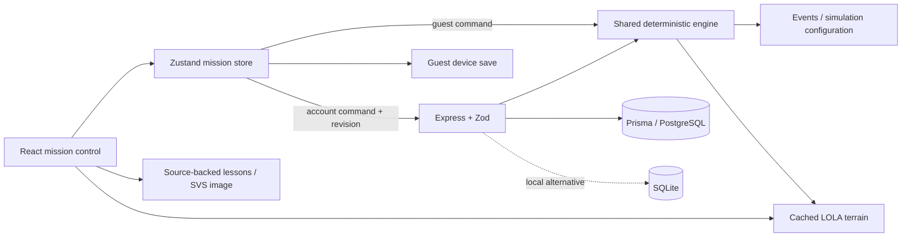

# Architecture and development priorities

The full challenge was reviewed before implementation. The critical acceptance path is a complete mission, real scientific data, consequential decisions, clear explanations, secure persistence, and verified delivery.

## System

## Boundaries

- `packages/simulation-engine`: pure initial state, commands, daily calculations, outcomes, scoring, save validation. No React, networking, clock, or uncontrolled random source.
- `packages/shared-config`: authored educational content and source references. Events are TypeScript data in the engine, not UI conditionals.
- `apps/web`: routes, accessible controls, UI state, guest persistence, account command transport, charting, and the NASA data display layer.
- `apps/api`: password/session handling, ownership checks, validation, state transitions, database transactions, learning/data endpoints.
- `prisma/schema.prisma` / `prisma/migrations`: production PostgreSQL.
- `prisma/sqlite/`: structurally equivalent development database.
- `scripts/ingest-nasa.mjs`: reproducible data preparation; no NASA network dependency during gameplay.

The cached dataset lives in `apps/web/src/data/nasa` and is imported as static read-only data by the engine and API. This keeps one source of truth in a small monorepo. A package extraction is appropriate if additional applications are added.

## Priorities and milestones

1. Foundation and playable mission: React shell, pure state machine, seven resources, eight events, five daily cycles, success/failure and restart. Verified with engine tests before completing the UI.
2. Science: verify a real PDS label, ingest LOLA data, connect relief to site setup/survey costs, cache NASA imagery, write limitations and source-backed lessons.
3. Experience: dark [Orbital observatory](ORBITAL_DESIGN.md), shared design tokens, compact header/mobile navigation, eight selectable SVG rooms, contextual resource/action/science panels, real-state telemetry traces, critical alerts, chronological journal, NASA Explorer and results. [Habitat systems](HABITAT_DESIGN.md), the shared engine and APIs remain the foundation.
4. Persistence/security: hashed passwords, opaque session cookies, Prisma migrations, account commands calculated on the server, ownership, stale revision rejection, profile/history.
5. Verification/delivery: component/API/browser tests, production bundles, deployment configuration, science provenance, and presentation documentation.

Optional 3D, sounds, live space-weather feeds, social features, payments, and a complex admin interface were excluded from the initial scope. They do not improve the core acceptance path enough to justify their initial cost.

## State and synchronization

Every command returns a new state. Guest updates are computed locally and persisted to a versioned browser key. Account updates submit only a command and expected revision. The server validates the transition and atomically updates the state, decision row, and results. The API rejects arbitrary state and score uploads. A stale revision returns 409 and the Save button reloads current server state.

Resource state, history, and logs are bounded by the five-day mission. Routes for science, results, mission control, and profile are lazy loaded. Fonts, the small terrain product, and the selected NASA image are locally bundled. The application honors reduced motion and provides semantic navigation, keyboard focus, Radix modal focus handling, error/loading/empty states, and a render error boundary.

## Scientific classification

The application marks measured terrain, NASA-backed references, rendered scientific imagery, and game assumptions separately. Normalized resource values have no claimed real-world unit conversion. The turn duration is explicitly one **Earth day**, not one lunar solar day.
